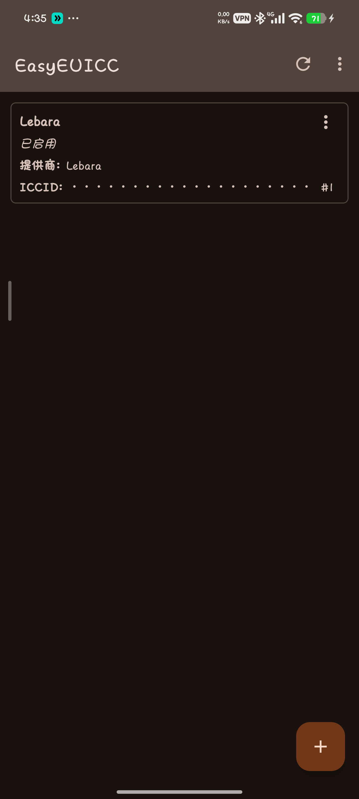
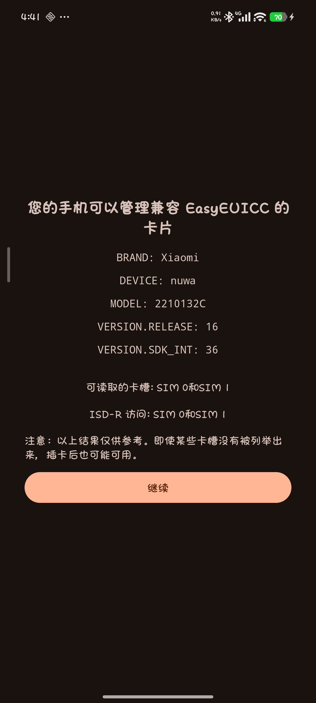
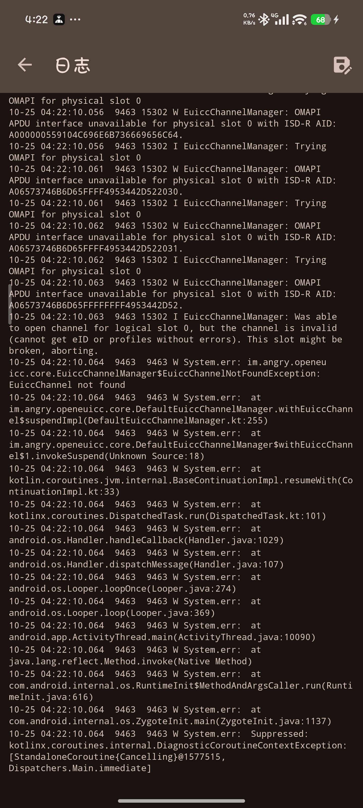

事情是这样的。

我用的是那种可以自己写卡的可移除 eUICC（俗称 5ber 那一类），平时靠 easyEUICC 管理卡里的几个 profile。前几天我手贱在 MIUI 的设置里把卡槽 2 关了一下，之后又插拔折腾了一阵，结果就出问题了。

easyEUICC 里显示得好好的，切换 profile 也提示成功，但手机的状态栏里始终是一个「未插入 SIM 卡」的小图标。设置里点进去看，卡槽 1 直接是灰的。



更气人的是，它之前明明是好的。

于是我决定用 adb 从头查一遍。这篇就把整晚的排查过程完整记下来，包括我走错的那几条路，毕竟我踩过的坑可能就是你明天要踩的坑。

### 第一步先别急着怀疑软件

本机根本没装 adb，先下了份 platform-tools。然后就是经典的开门不顺，adb 的 daemon 起不来，报 `cannot open ...\Temp\adb.log: Permission denied`，把 `TMP`/`TEMP` 重定向到工作目录才勉强起来，结果设备是 `offline`。

`adb reconnect offline` 之后设备干脆彻底消失了。

去 Windows 的设备管理器里翻，看到这么一行。

```text
Error  Unknown USB Device (Set Address Failed)   USB\VID_0000&PID_0004\EBAEF824
```

VID 是 `0000`。这四个零的意思很直白，USB 枚举压根就没走完，系统连这是个什么设备都没认出来。这跟 eSIM 一点关系都没有，纯粹是线材或者端口的问题。

换了条原装数据线，设备立刻上线，`unauthorized` 闪一下就变成 `device`。

顺便记一个教训，`VID_0000` 这种报错不要浪费时间去查驱动、查系统版本、重装 adb，先换线。

### 取证：卡明明在位，系统却说没准备好

设备认出来了，开始抓状态。

```text
gsm.sim.state        = [NOT_READY, LOADED]
gsm.operator.numeric = [,46011]
```

卡槽 1 是 `NOT_READY`，卡槽 2 是 `LOADED`，电信 46011 正常。

这两个状态的区别很重要。`ABSENT` 表示物理上没卡，`NOT_READY` 表示卡在位、但 UICC 应用没被激活。也就是说，系统知道这里有张卡，但它没有去读。

接着看 `dumpsys isub`，当前唯一活跃的 subscription 是卡槽 2 的电信卡。eUICC 卡里的那些 profile 全是 `simSlotIndex=-1`，也就是没有一个在线。

再看 `dumpsys secure_element`。

```text
TERMINAL: SIM1
  mIsConnected: true
  mUseAra: true
  refresh tag: 32:10:C4:15:2A:5E:65:1A
  rule 1: AID_REF_DO: 4f00 -> mPackageName=im.angry.easyeuicc, ALLOWED

TERMINAL: SIM2
  mUseAra: false
```

SE 层一切正常，通道连着，ARA 规则里 easyEUICC 是被允许的。这张卡在安全元件这一层完全健康。

到这里就很诡异了，一条路说卡好得很，另一条路说卡不存在。

### 两次误判，和两次被自己打脸

第一次翻 `telephony.db` 的 `siminfo` 表时，我看到 eUICC 卡的 `card_id` 名下挂着 5 条记录，其中两条 `enabled=1`，当时就断定是 MEP 端口冲突。

结果被一句话推翻，「我的 easyEUICC 只显示有 Lebara 这张卡，其他应该早就被我删了」。

也就是说那些记录全是删除 profile 之后残留的幽灵行，压根不参与工作，冲突无从谈起。

第二次，我把注意力放到了 Lebara 那条记录的 `uicc_applications_enabled=0` 上，得出「Lebara 被禁用了」的结论。

又被推翻，「本来 Lebara 就是启用的」。

现在回头看，这个字段我前后翻到过两次，两次都理解错了它的语义。一次把它当成端口映射，一次把它当成一个普通的开关。真相其实一直躺在屏幕上，只是我没看懂它。

### 一段差点把卡弄废的弯路

中间我一度想直接重来，把所有东西都重置。

这里要分清楚两件事，在 easyEUICC 里「删除 profile 再重新添加」，和「擦除 eUICC 芯片」（也就是 ES10c 里的 `eUICCMemoryReset`），完全不是一个量级的东西。

删除 profile 只清那一个 profile 的数据。memory reset 是把整张卡的存储和配置全部重置，包括 ISD-R 和 MEP 端口映射。

后来我确实做了 memory reset，擦除成功、重新下载成功、启用成功，这一整套流程跑得非常顺，反而证明了卡片本身功能完好，一点毛病没有。

但 `gsm.sim.state` 依然是 `NOT_READY`。

我得诚实说一句，这一步其实是有点赌的。memory reset 中途要是 APDU 断连，卡可能就停在半擦除状态直接报废，而当时通道本来就在报 `Secure Element is not connected`。真正该做的顺序是先把物理层和通道坐实，最后才动卡。这次运气好，卡没坏，但这不是一个可以随便推荐的操作。

顺便一提，擦除的确认框要求你手打一整句中文，而 `adb input text` 只支持 ASCII，这句只能自己敲。

走到这一步，我列了张表把可能性一条条划掉。

| 怀疑点 | 实测结果 | 结论 |
| :--- | :--- | :--- |
| USB 线材 | 换原装线后设备正常上线 | 与 eSIM 无关 |
| 卡槽 1 硬件 | 插电信卡 `LOADED` | 正常 |
| 卡槽 2 硬件 | 插电信卡 `LOADED` | 正常 |
| 卡片物理 | 插到另一台手机上能读、能连信号 | 正常 |
| 卡片数据 | ATR、EID、SGP.22 2.2.2、SAS、NURAM 剩余空间、GSMA 证书全部可读 | 正常 |
| profile 数据 | memory reset + 重新下载 + 启用，全部成功 | 正常 |
| 卡槽位置 | eUICC 卡换到卡槽 2 仍然 `NOT_READY` | 与卡槽无关 |
| 重启 modem | `cmd phone restart-modem` 后状态不变 | 无效 |
| 整机重启 | 状态不变 | 无效 |

把 eUICC 卡换到卡槽 2 之后，`gsm.sim.state` 变成了 `LOADED, NOT_READY`，位置刚好对调。问题跟着卡走，不跟着卡槽走。卡槽兼容性这个假设到此彻底排除。

### 转折点来自一句回忆

就在我准备开始怀疑 ROM 的时候，一句特别随意的话出现了。

「我记得是我手动在设置里关闭 sim2 就识别不到了」。

这一句是全场的钥匙。

### 真凶：一个被写成 0 的标志位

重新把 `siminfo` 表拉出来，一行行看。

```text
 _id name                       sim_id port  en  card_id
   1 中国电信                           -1   -1   1  89860320245125795844
   2 1O1O / csl / Club Sim          -1   -1   0  89086030202200000025000063008133
   3 Roamless                       -1   -1   1  89086030202200000025000063008133
   4 中国联通                           -1   -1   1  89860124801189388674
   5 中国电信                            0    0   1  89860325745150140407
   6 Club                           -1   -1   0  89086030202200000025000063008133
   7 GLOBE                          -1   -1   1  89086030202200000025000063008133
   8 EE                             -1   -1   1  8944110069328643955F
   9 Lebara                         -1   -1   0  89086030202200000025000063008133
```

看 Lebara 那一行的 `en`，也就是 `uicc_applications_enabled`，是 0。

MIUI 设置里的「关闭 SIM 卡」，底层调的是 `setUiccApplicationsEnabled(subId, false)`，它会把这张卡名下所有 subscription 记录的 `uicc_applications_enabled` 全写成 0。之后重新插卡，Telephony 按 ICCID 匹配到那条 `enabled=0` 的记录，就认定这张卡的 UICC 应用是被禁用的，于是根本不去激活它。modem 因此永远拿不到 USIM，`gsm.sim.state` 就卡死在 `NOT_READY`。

然后就形成了一个死锁。卡不被识别，设置里就看不到这张卡，看不到就没法从设置里重新打开它，只能去动数据库。

同一个字段对普通 SIM 卡的影响微乎其微，但对可移除 eUICC 就是致命的，因为它的 profile 能不能被 modem 读到，完全取决于 Android 有没有激活 UICC 应用。

### 为什么这么难查：能读卡 ≠ 系统认卡

这是我这次最大的收获。

整个排查过程中，easyEUICC 能读到这张卡的全部信息，EID、ATR、SGP.22 版本、SAS 认证号码、NURAM 剩余空间、证书签发者，一个都不缺。这些字段每一个都需要完整的多轮 APDU 交互才能拿到。

也就是说 OMAPI 这条链路是完全通的。



但 Telephony 拒绝激活 UICC 应用，走的是另一条完全独立的路径。两条路径互不关心，一条通不代表另一条通。所以「卡能读出来」和「系统认这张卡」是两件不同的事，我前面有一大半时间都在被这个错觉带着跑。

真正让我绕远路的，是下面这种日志。



看起来像是卡槽坏了、通道断了，但它其实只是 eUICC 里没有可用的 profile 可以激活，跟 SE 通道本身能不能用没关系。

中间还有个干扰项，这台机器的 ROM 挺混的。

```text
system / product / system_ext  →  Android 16  (HyperOS 3, OS3.0.309.0.WMBCNXM)
vendor / bootimage / dlkm      →  Android 13
secure_element HAL             →  HIDL 1.0 / 1.1 / 1.2（没有 AIDL 版本）
android.hardware.telephony.euicc feature → 缺失（国行阉割）
com.miui.euicc                 →  包不存在，只留下权限声明
```

我一度判断是 ROM 的 modem 兼容缺陷，还专门装了个 KernelSU 模块把 `android.hardware.telephony.euicc` 这个 feature 补上，把 `com.google.android.euicc` 也启用了起来。服务确实注册成功了，`EuiccController` 和 `EuiccCardController` 都起来了，但 MIUI 的 ALR 不让它自启动，进程一直是 `app=null`，空转。

这些折腾对最后的修复没有直接帮助，留着倒也没坏处。

教训是，ROM 复杂不等于根因在 ROM。复杂的系统更容易让人把「我看不懂的现象」归因到「系统有问题」上，然后就放弃了。

### 修复过程

找到根因之后，修复本身只有几行。

```powershell
# 1. 导出数据库
adb shell "su -c 'cp /data/user_de/0/com.android.providers.telephony/databases/telephony.db /data/local/tmp/t.db && chmod 666 /data/local/tmp/t.db'"
adb pull /data/local/tmp/t.db ./telephony.db
```

```sql
-- 2. 把这张卡名下所有记录的应用启用标志改回 1
UPDATE siminfo SET uicc_applications_enabled = 1
WHERE card_id LIKE '890860302%';
```

```powershell
# 3. 写回，注意权限和 SELinux 上下文都要对
adb push ./telephony.db /data/local/tmp/t.db
adb shell "su -c 'cp /data/user_de/0/com.android.providers.telephony/databases/telephony.db{,.bak}; cp /data/local/tmp/t.db /data/user_de/0/com.android.providers.telephony/databases/telephony.db; chown radio:radio /data/user_de/0/com.android.providers.telephony/databases/telephony.db; chmod 660 /data/user_de/0/com.android.providers.telephony/databases/telephony.db; restorecon /data/user_de/0/com.android.providers.telephony/databases/telephony.db; rm -f /data/user_de/0/com.android.providers.telephony/databases/telephony.db-{journal,wal,shm}'"

# 4. 重启
adb reboot
```

重启之后，状态直接反转。

```text
修复前:  gsm.sim.state = LOADED, NOT_READY
         gsm.sim.operator.numeric = 46011,
         persist.radio.mbn_sw_sub1 = Inactive / ROW_Commercial（反复跳变）

修复后:  gsm.sim.state = LOADED, LOADED
         gsm.sim.operator.numeric = 46011, 20404
         persist.radio.mbn_sw_sub1 = Netherlands-VoLTE-Vodafone(0x0A0104F3)
         ril.mcc.mnc1 = 20404
```

连观察 30 秒，`LOADED, LOADED` 一直很稳。卡槽 1 是电信 46011，卡槽 2 的 Lebara 走的是 20404，漫游在中国移动的 46000 上。

那个 `mbn_sw_sub1` 从 `Inactive` 变成 `Netherlands-VoLTE-Vodafone` 也很值得一看，它说明 modem 终于能识别出这是哪家运营商了。之前它一直选不出配置，是因为根本读不到 USIM。

### 顺手把幽灵记录清了

修完之后我又顺手清了下数据库。那 7 条 `sim_id=-1` 的记录都是历史遗留，插卡时的匹配就是被它们搞乱的源头之一，留着没意义。

```text
deleted 7 rows
REMAINING: (5,中国电信,0), (9,Lebara,1)
```

重启后再验证，双卡依然正常，数据库从 9 条瘦到 2 条，世界清净了。备份留在设备的 `telephony.db.bak_clean` 和本地一份，随时可以回滚。

### 一些经验，和一份排错顺序

第一条，也是最重要的一条，**别再用 MIUI 设置里的「关闭 SIM 卡」了**。对可移除 eUICC 来说，一旦关掉，重新打开的操作很可能会失败，因为卡已经不被识别，设置里压根看不到它，然后你就掉进同一个死锁。这次就是从这个操作开始的。

第二条，**遇到同类症状先去查数据库，别急着擦卡**。`uicc_applications_enabled` 应该是第一个被检查的字段，它就在 `siminfo` 表里，一条 SQL 就能看明白。memory reset 那种操作应该是最后手段。

第三条，给你一份我总结的排错顺序，从便宜到贵。

```text
1. 查 gsm.sim.state，确认是哪个卡槽，区分 NOT_READY 和 ABSENT
2. 查 siminfo 的 uicc_applications_enabled（先用这个，别急着擦卡）
3. 查 dumpsys secure_element，确认 SE 层和 ARA 规则是否正常
4. 换卡槽交叉验证，看问题是跟着卡走还是跟着卡槽走
5. 换设备验证卡片本身
6. 最后才考虑 memory reset 和换 ROM
```

第四条，「卡能读」不等于「系统认卡」。OMAPI 和 Telephony 是两条独立的路径，排查的时候要分开看待，别用一条链路的正常去否定另一条链路的异常。

第五条，你自己对设备的操作记忆，是整场排查里最有价值的线索。这次把我从两次错误方向里拽回来的，都是很随意的一句回忆。折腾之前多想想「我上次动过什么」，比任何工具都管用。

最后说一句免责的话，这篇里的操作涉及 root 改系统数据库，动之前请务必备份 `telephony.db`，改完记得把 `chown`、`chmod`、`restorecon` 都做对，不然系统读不到你的数据库会更麻烦。

### 结尾

整晚折腾下来，从 USB 线材一路查到 ROM 构建信息，从卡槽硬件查到 eUICC 内存擦除，最后真正让我修好这台手机的，是数据库里一个 0 变成了 1。

说真的，我一开始还怀疑过是手机要废了、卡要废了、这个 ROM 有毛病，结果它就只是一个标志位。

也许多年以后我还会记得这个晚上，不是因为我学会了什么高深的调试技巧，而是因为我在一个自己看不懂的现象面前，反复怀疑了太多不该怀疑的东西，唯独漏掉了最简单的那一个。

以上。
